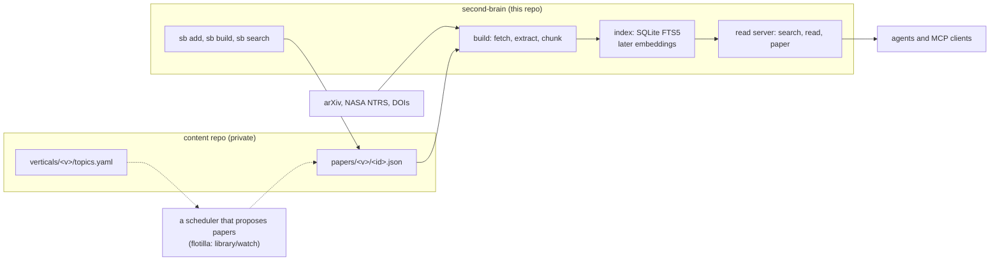

# RFC-0001 — The library: a research corpus you choose, searchable over MCP

**Status:** Draft (2026-11-26). The operator decided its scope the same day: public tooling here,
the content in a private repo, four verticals to start (ai, software, robotics, space), one PDF
dependency allowed, and flotilla running the periodic search. Moved here from flotilla's draft
RFC-0015, which keeps only flotilla's side.

## 1. What this is for

A second brain answers questions from what its owner reads, hears, writes and decides. Most of
that already lives in systems with their own search (podcasts, documents, tasks, meetings), and an
agent can read those live. One source is missing: **the research papers** behind the work. The
library is that source: papers the owner chose, held privately, searchable, cited by section, and
kept current.

The first installation's verticals:

| Vertical | Serves |
| --- | --- |
| `ai` | agent platforms: models, agents, tool use, RAG, evaluation, agent security |
| `software` | a bug-fixing agent fleet and services: LLMs for code, program repair, testing, operations |
| `robotics` | a robotics lab: navigation and exploration, locomotion and sim-to-real, robot learning |
| `space` | an orbital-mechanics learning site: Lambert solvers, trajectories, ephemerides, landing |

A vertical is data in the content repo, not code: adding one is a folder and a topics file.

## 2. Where it stops

- **Papers first.** Blogs go where the owner already collects them; podcasts, documents and
  meetings stay where they are and are read live by whoever asks.
- **Chosen, not crawled.** A paper joins because a person approved it.
- **Tooling here, content elsewhere.** This repo never holds a corpus (AGENTS.md rule 1).
- **No asking across sources.** The library is one source. Combining it with others, recording
  what was read and checking citations belong to the agent that asks (flotilla's case 1, or any
  MCP client).
- **Personal use.** Papers keep their authors' licences; NASA technical reports are public domain.
  Nothing here republishes a paper.

## 3. The shape

### 3.1 The content repo is the corpus's definition

- `verticals/<v>/topics.yaml`: the vertical's sub-topics, each with search queries (arXiv
  categories and terms, NTRS terms). A scheduler reads it to propose new papers.
- `papers/<v>/<id>.json`: one manifest per paper: the versioned source id (`arxiv:2001.00001v3`,
  `ntrs:20190000123`, `doi:...`), title, authors, year, sub-topic, tier (foundational or recent),
  why it is in, and who decided (an approver and a reference, or "seeded").
- **Texts are not in git.** They are derived: fetched again from the versioned id at build time and
  kept in the installation's corpus folder, backed up with its other volumes. A lost folder is
  rebuilt from the manifests.

### 3.2 Text and index

- **The text, best source first:** arXiv's HTML (most papers since late 2023, with sections), then
  the PDF through one PDF-to-text library (allowed 2026-11-26; pure Python such as `pypdf` first,
  pinned, measured on the older papers), then the abstract alone, marked as such.
- **Chunks by section,** each with its paper, section title and position, so a read returns one
  section and a citation names it.
- **The index:** SQLite FTS5 with BM25 over chunks and titles. **Embeddings come only if §5's
  evaluation shows BM25 misses;** then a local embedding model through an OpenAI-compatible
  `/embeddings` endpoint, its model and version recorded in the index, and a hybrid ranking. Where
  the vectors live is decided then, with the measurement.
- **A build** reads the manifests at a commit, fetches what is missing, and writes a new index
  folder, swapped in whole, with the content repo's commit as its `VERSION`. Every result names the
  version it came from.

### 3.3 The read server

A small read-only MCP server (streamable HTTP) over the index. It mounts the corpus read-only and
holds no credential.

| Tool | Returns |
| --- | --- |
| `search(query, vertical?, k?)` | the top chunks: paper id, title, year, section, a snippet, the score, the index version |
| `read(paper, section?)` | one section's text, or the abstract and the section list; capped |
| `paper(id)` | the manifest: title, authors, why it is in, links |

The tools are a contract (AGENTS.md rule 3): their names and fields change only with a version.

### 3.4 The CLI

`sb add <id> --vertical v --why "..."` writes a manifest (after checking the id against its
source); `sb build` builds the index; `sb search "..."` queries it locally; `sb serve` runs the read
server. A scheduler's approved proposal calls the same path as `sb add`.

## 4. Keeping it current

A scheduler proposes, a person approves, the manifest is written. In the first installation the
scheduler is flotilla (its RFC-0015): a weekly routine per vertical queries arXiv and NTRS with
the vertical's topics and proposes each new paper as an action a person approves. The approved
proposal becomes a commit to the content repo, through a credential for that repo only. Nothing in
this repo depends on flotilla; any scheduler can do the same through `sb add`.

## 5. How we know it works

- **Retrieval:** 40 questions, 10 per vertical, each with the papers that answer it, written by the
  owner from the seeded list. Measured: recall at 5 for BM25 alone. Embeddings are added for a
  vertical whose recall at 5 is under 0.8, and kept only if the hybrid beats BM25 on the same
  questions.
- **Tests here:** a fixture library (three manifests: one with HTML, one PDF only, one abstract
  only), a build, each tool's answer, the read-only mount refusing a write, and a rebuild giving the
  same index for the same commit.

## 6. Order of work

1. **The research pass** (running, 2026-11-26): four candidate lists, each paper verified against
   arXiv's or NTRS's API or a resolving DOI; the owner prunes them; the pruned lists become the
   seeded manifests in the content repo.
2. **The content repo's layout:** the verticals' topics and the seeded manifests.
3. **Here:** the manifest schema and `sb add`; the fetchers and the extraction; the build and the
   FTS5 index; the read server; the fixture tests.
4. **The retrieval evaluation** (§5); embeddings only if it says so.
5. **The installation:** the build and the read server beside the agent platform's reads worker,
   on its MCP network.

## 7. Decisions for the operator

1. **The first pass's size:** keep everything verified and prune by hand, or cap each vertical
   (for example 100) first.
2. **Where the build and the read server run:** on the control-plane host beside the reads worker
   (recommended), or on the model host.

## 8. Not covered

- Papers behind paywalls: kept as their abstract only.
- Figures, tables and equations: HTML keeps some as text; a PDF's are mostly lost.
- Whether a local embedding model is served today.
- Ranking across sources: each source ranks its own results; the asking agent chooses and cites.
